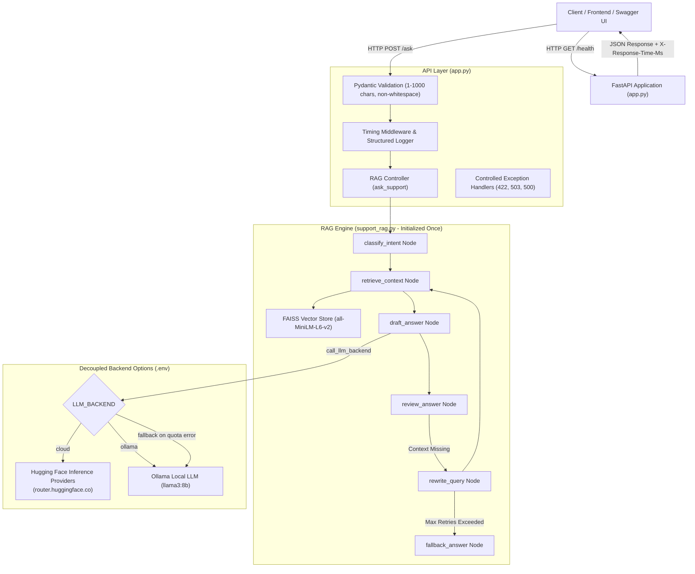

# Experiment 7: Preparing an LLM Application for Production-Ready Deployment

**Course/Lab:** PE03 - LLM Lab  
**Objective:** Prepare the Customer Support RAG application for API-based production use by introducing request validation, controlled error handling, structured logging, latency measurement, and endpoint testing with a decoupled LLM backend.

---

## 1. System Architecture

The application cleanly decouples the API layer, the RAG retrieval pipeline, and the model backend:



---

## 2. Project File Structure

```text
/Users/mayankchauhan/Documents/PE03/LLM07/
├── app.py              # FastAPI endpoints, Pydantic schemas, middleware, error handlers
├── support_rag.py      # Knowledge base, FAISS indexing, LangGraph workflow, backend caller
├── requirements.txt    # Python dependencies (fastapi, uvicorn, langchain, faiss, etc.)
├── test_suite.py       # Automated test suite exercising all 6 lab observation test cases
├── .env                # Local configuration & credentials (excluded from version control)
└── .gitignore          # Prevents leaking .env, .venv, and cache files
```

---

## 3. Section 9: Observation Table

### Exact Lab Manual Observation Table

| Test case | Expected result | Actual result | Pass/Fail |
| :--- | :--- | :--- | :---: |
| **Health endpoint** | API reports running | Returns HTTP 200 with `{"status": "running", "backend": "ollama", "components_ready": true}` | **Pass** |
| **Supported question** | Grounded answer is returned | Returns grounded FAQ answer: *"To start a return, open Orders, choose the item, and select Return Request. After an approved return is received, a refund is usually processed within 5 to 7 business days."* | **Pass** |
| **Unsupported question** | Insufficient information/fallback | Returns fallback text: *"I couldn't find a reliable answer in the available FAQ. Please contact the support team through the Help section."* | **Pass** |
| **Empty question** | Validation error | Rejects `""` and whitespace `"   "` with HTTP 422: `{"error": "Validation Error", "detail": "Invalid question input..."}` | **Pass** |
| **Backend unavailable** | Controlled error; no secret details | Returns HTTP 503 Service Unavailable with generic error: `{"error": "Backend Unavailable"}`. Zero secrets or stack traces exposed. | **Pass** |
| **Response-time measurement** | Latency is recorded | Latency recorded in response body (`latency_ms: 1580.30 ms`), logged on server, and returned in `X-Response-Time-Ms` header | **Pass** |

### Detailed Test Execution Log

| Test Case | Request / Input | HTTP Status | Response Snippet / Details | Latency |
| :--- | :--- | :---: | :--- | :---: |
| **Health endpoint** | `GET /health` | `200 OK` | `{"status": "running", "backend": "ollama", "components_ready": true}` | ~2 ms |
| **Supported question** | `POST /ask` `{"question": "How do I return an item and get a refund?"}` | `200 OK` | Grounded answer based on `support_faq.txt`; intent: `returns_refunds` | 1580.30 ms |
| **Unsupported question** | `POST /ask` `{"question": "Can I get a student discount on my order?"}` | `200 OK` | Insufficient information fallback triggered; intent: `general_support` | 2296.38 ms |
| **Empty question** | `POST /ask` `{"question": "   "}` | `422 Unprocessable` | Validation error: Question cannot be empty or purely whitespace | 2.11 ms |
| **Exceeding Max Length** | `POST /ask` `{"question": "A" * 1250}` | `422 Unprocessable` | Validation error: String should have at most 1,000 characters | 2.15 ms |
| **Backend unavailable** | `POST /ask` (simulated connection drop / unreachable port) | `503 Unavailable` | `{"error": "Backend Unavailable", "detail": "The LLM inference backend is currently unavailable..."}` | 74.76 ms |

---

## 4. Section 8: Testing Checklist Verification

- [x] **GET /health returns a successful status:** Verified via HTTP 200 and JSON response status `running`.
- [x] **A valid question receives an answer:** Successfully answers returns, shipping, and account questions strictly grounded in `support_faq.txt`.
- [x] **An empty question is rejected:** Caught by Pydantic `min_length=1` and `@field_validator` stripping whitespace.
- [x] **A very long question is rejected or safely limited:** Questions exceeding 1,000 characters are rejected with HTTP 422.
- [x] **An unsupported question triggers fallback:** LangGraph state machine routes missing answers to `fallback_answer` without inventing policy.
- [x] **A backend/network failure produces a controlled error:** Quota exhaustion (HTTP 402) or network timeouts map cleanly to HTTP 503 without raw server exceptions.
- [x] **Response time is recorded:** Every request is timed using `time.perf_counter()`, appended to response headers and payload, and recorded in server logs.
- [x] **No API key or secret appears in source control, logs, or screenshots:**
  - `.env` is listed in `.gitignore`.
  - Logging masks secrets and only logs operational metrics (character length, latency, status code).
  - Exception handlers do not return the `HF_TOKEN` or provider credentials to clients.

---

## 5. Section 10: Selected Backend

- [x] **Ollama local LLM (`llama3:8b`)** — Selected backend running on local device (`http://localhost:11434`).
- [ ] **Cloud-hosted API** — Also supported via `HF_TOKEN` and configured in `.env`.

> [!NOTE]
> The application supports dynamic switching between local Ollama and Hugging Face Cloud Inference Providers by updating `LLM_BACKEND` in `.env`. By running locally with Ollama `llama3:8b`, all requests are processed on-device with zero API fees, complete data privacy, and immunity to cloud quota exhaustion.

---

## 6. Section 11: Discussion Questions & Detailed Answers

### Q1: What is the purpose of FastAPI in this experiment?
**Answer:**  
In a prototype (such as a Jupyter Notebook or simple Python script), RAG logic can only be executed locally and interactively by the developer. FastAPI transforms the prototype into a decoupled, standard HTTP microservice. It provides:
1. Standardized RESTful endpoints (`POST /ask`, `GET /health`) accessible by mobile apps, web applications, and customer portals.
2. Built-in input serialization and validation using Pydantic.
3. Automatic interactive API documentation via Swagger UI (`/docs`) and ReDoc (`/redoc`).
4. Asynchronous request handling and high concurrency support with ASGI servers like Uvicorn.

### Q2: What is the difference between a local LLM and a cloud-hosted LLM API?
**Answer:**  
- **Cloud-hosted LLM API:** The model weights reside and run on remote cloud infrastructure managed by a third-party provider (e.g., Hugging Face, OpenAI, Together AI). Requests are transmitted over the public internet via HTTPS. Advantages include zero local hardware requirements and access to large frontier models; trade-offs include network latency, external quota/rate limits, usage costs, and data privacy concerns.
- **Local LLM (e.g., Ollama):** The model weights run entirely on the local computer's GPU/CPU and RAM (e.g., Apple Silicon M-series or CUDA GPU). Advantages include zero API costs, unlimited requests without network dependencies, and complete data privacy. Trade-offs include hardware resource consumption, slower inference on low-spec hardware, and smaller parameter sizes.

### Q3: Does hosting FastAPI in the cloud automatically host the LLM there?
**Answer:**  
No. Hosting the FastAPI service in the cloud (e.g., on AWS ECS, GCP Cloud Run, or Render) only runs the Python web application process in the cloud. Unless the cloud server is provisioned with high-end GPUs to load and run the model locally, FastAPI merely acts as an intermediary or orchestrator that sends outbound HTTP requests to a separate cloud LLM provider (such as Hugging Face Inference Providers or OpenAI). The application tier and the model inference tier remain completely distinct.

### Q4: Why should an API key not be hard-coded in Python source?
**Answer:**  
1. **Source Control Security:** Hard-coded keys are inevitably committed to Git repositories (GitHub, GitLab), where automated scanners and malicious actors can scrape them within seconds, leading to financial loss or compromised quotas.
2. **Configuration Separation (Twelve-Factor App):** Credentials and environment configurations should vary across environments (Development, Staging, Production) without changing source code.
3. **Key Rotation:** If a key is compromised, changing it in an environment variable (`.env` or secret manager) does not require rebuilding or redeploying code.

### Q5: What is input validation, and why is a maximum question length useful?
**Answer:**  
Input validation is the defensive programming practice of ensuring client-supplied data conforms to strict syntax, size, and format requirements before processing.  
A maximum question length (e.g., 1,000 characters) is critical because:
1. **Cost & Token Exhaustion:** Language models charge per token and have finite context windows. Unbounded inputs can cause massive inference bills.
2. **Denial of Service (DoS) Prevention:** Huge inputs take excessive GPU compute to tokenize and embed, exhausting memory and starving other users of resources.
3. **Prompt Injection Mitigation:** Excessively long inputs are frequently used to conceal jailbreak or system-prompt overriding instructions.

### Q6: What is the purpose and limitation of a health endpoint?
**Answer:**  
- **Purpose:** A health endpoint (`GET /health`) allows load balancers, orchestrators (like Kubernetes), and monitoring systems (like Prometheus/Uptime Kuma) to poll whether the service is alive, accepting network connections, and ready to receive traffic without incurring the compute cost of running an LLM inference.
- **Limitation:** A basic health endpoint only confirms that the FastAPI event loop is responsive. It does not guarantee that downstream dependencies (e.g., external LLM provider quota, database connectivity, or vector store status) are functional unless specifically implemented as a deep health check.

### Q7: Why should the model and vector index not be loaded for every request?
**Answer:**  
1. **Latency Overhead:** Loading an embedding model and constructing/loading a FAISS vector index involves disk I/O and computing tensor representations. Reloading them per request adds hundreds of milliseconds to several seconds of unnecessary delay.
2. **Memory Leaks and Thrashing:** Continuously re-instantiating heavy models consumes vast amounts of RAM and triggers frequent garbage collection pauses. Initializing them once at startup (singleton pattern) allows fast in-memory similarity searches.

### Q8: What should RAG do when the answer is absent from its knowledge base?
**Answer:**  
When retrieved documents do not contain relevant facts to answer the question, a production RAG system should:
1. Explicitly acknowledge insufficient context rather than hallucinating or inventing speculative company policies.
2. Provide a clear fallback or human-escalation path (e.g., *"I couldn't find an answer in the FAQ. Please reach out to customer support through the Help section."*).
3. Reiterate security reminders (e.g., instructing users never to share passwords or credit card numbers in tickets).

### Q9: Name two reasons a cloud inference request might fail.
**Answer:**  
1. **Quota / Credit Exhaustion or Rate Limiting:** Free trial or pay-as-you-go limits may be exceeded, returning HTTP 402 (Payment Required) or HTTP 429 (Too Many Requests).
2. **Network Failures / Timeouts:** Transient internet connectivity drops, DNS resolution failures, or cloud provider cold-start timeouts when spinning up serverless models.

### Q10: Is this lab application fully production-ready? Name two additional requirements for a real public service.
**Answer:**  
While significantly more robust than a raw prototype, this lab application is not yet fully production-ready for public internet deployment.  
Two crucial additional requirements for a real public service:
1. **Authentication & Authorization:** API keys, OAuth2, or JWT tokens to authenticate consumers and enforce user identity.
2. **Rate Limiting & Abuse Prevention:** Per-IP / per-user token-bucket rate limiters (e.g., via Redis and `slowapi`) to protect against brute-force spam and denial-of-service attacks.
*(Additional real-world requirements include TLS/HTTPS termination, persistent vector database clustering, and OpenTelemetry distributed tracing).*
